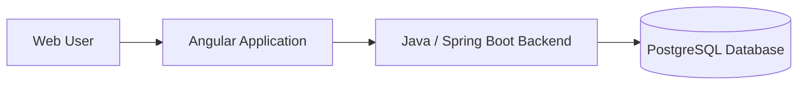

# Event Quizzer

**Full-stack questionnaire and evaluation management application** built with Java, Spring Boot, PostgreSQL, and Angular.

Event Quizzer is a client-commissioned web application developed to support questionnaire and evaluation workflows. The project demonstrates independent, end-to-end application development, from database design and backend implementation to the web interface.

> **Project type:** Freelance / client project  
> **Role:** Sole Full-Stack Developer  
> **Source code:** Shared publicly with the client's permission

## Technology Stack

| Layer | Technology |
| --- | --- |
| Backend | Java, Spring Boot |
| Frontend | Angular, TypeScript |
| Database | PostgreSQL |

## Project Overview

The application brings together a browser-based interface, backend application logic, and relational data storage to support questionnaire and evaluation processes.

The work covered:

- Designing the relational database structure in PostgreSQL.
- Implementing application logic and backend functionality in Java and Spring Boot.
- Building the web interface with Angular and TypeScript.
- Integrating the frontend, backend, and database into a complete application.
- Delivering the project independently for a client.

## High-Level Architecture

This diagram shows the project's technology layers. It is a high-level overview rather than a detailed deployment or infrastructure diagram.

## Engineering Responsibilities

As the sole developer, I was responsible for the complete implementation of the solution:

**Backend development** — Building and integrating the Java/Spring Boot application layer.

**Database design** — Defining and implementing the PostgreSQL data model.

**Frontend development** — Creating the Angular application and connecting it to the backend.

**End-to-end delivery** — Coordinating and implementing the solution across all three layers.

## Running the Project Locally

The application requires its Spring Boot backend, Angular frontend, and a configured PostgreSQL database.

Before running it locally:

1. Review the backend build configuration to identify the required Java version and build tool.
2. Create a local PostgreSQL database and configure the backend's database connection.
3. Install the frontend dependencies using the package manager specified by the Angular project.
4. Start the backend and frontend using the commands defined in their respective project configurations.
5. Configure the frontend to connect to the locally running backend, if necessary.

> **Note:** Repository-specific module paths, environment variable names, database initialization steps, and startup commands should be added after verifying the source structure. Do not commit real credentials or client production data.

## Project Background

Event Quizzer was developed as a freelance engagement for a client. The repository is shared as a professional portfolio reference with the client's permission.

The project highlights practical experience in full-stack engineering and independent software delivery, with a particular focus on Java-based backend development.

## Author

**Jorge Revelo** — Senior Backend Developer / Full-Stack Developer  
[GitHub](https://github.com/Saurio666) · [LinkedIn](https://www.linkedin.com/in/jrevelo19/)

## License and Usage

This project originated as client-commissioned work. Public visibility of the source code does **not** automatically grant permission to reuse, redistribute, or commercially exploit it. Refer to the repository's license, if one has been provided, and the applicable rights agreed with the client.

## Runtime secrets and local setup

The backend intentionally does **not** ship with database credentials or a token encryption key.
Set the following environment variables before running `eventquizzer`:

| Environment variable | Purpose |
| --- | --- |
| `EVENT_QUIZZER_DB_URL` | PostgreSQL JDBC URL (for example, `jdbc:postgresql://localhost:5432/your_database`) |
| `EVENT_QUIZZER_DB_USERNAME` | PostgreSQL username |
| `EVENT_QUIZZER_DB_PASSWORD` | PostgreSQL password |
| `EVENT_QUIZZER_TOKEN_SECRET` | A new random secret of at least 32 characters used for quiz tokens |

Do not commit real values, share them in issue reports, or use the previously embedded values.
The Spring Boot application will fail to start until these values have been configured.

**Important migration note:** changing the token secret invalidates previously generated encrypted quiz links. Regenerate links after deployment. If a database account in repository history was ever valid, rotate its password and review its permissions. Replacing files in the latest commit does not erase secrets from Git history; purge historical commits separately if required. The legacy token encryption mechanism is unchanged in this patch and should be modernized in a separate, compatibility-reviewed update.
